# 《鸣潮》系统拆解案

以角色养成为主线的游戏系统分析，讨论战斗、装备、资源、探索与终局玩法如何共同影响角色价值、队伍构筑和长期游玩。

[下载原始 Word 文档](%E5%90%8C%E6%B5%8E%E5%A4%A7%E5%AD%A6%E9%97%AB%E5%93%B2%E7%A5%AF_%E9%B8%A3%E6%BD%AE%E7%B3%BB%E7%BB%9F%E6%8B%86%E8%A7%A3%E6%A1%88.docx?raw=1)

## 目录

- [核心判断](#section-001)
- [一、角色价值如何进入长期循环](#section-002)
- [二、角色养成：从使用目标倒推基础成长](#section-003)
- [三、武器、声骸与共鸣链：三条线的分工](#section-009)
- [四、内部耦合：培养一支能运转的队伍](#section-018)
- [五、外部耦合：角色价值如何跨过版本边界](#section-026)
- [六、战斗系统：让养成优势进入实战](#section-033)
- [七、资源与探索：持续投入不等于填满时间](#section-039)
- [八、终局玩法：定义什么值得培养](#section-046)
- [九、经营影响：日活、月活、收入与长期兴趣](#section-052)
- [十、结论：养成的终点不只是面板](#section-058)
- [参考文献](#section-059)

## 文档正文

SYSTEM DESIGN PORTFOLIO

鸣潮

系统拆解

以角色养成为主线的 系统耦合与经营分析

一次角色获取，怎样变成 一支值得长期使用的队伍？

闫哲祯

同济大学  |  系统策划岗位作品集

观察基准  V3.7「镜锁妄世，心照红尘」

玩家经历  开服全勤 、 全图100%探索、UID: 103177852

## 核心判断

鸣潮的角色养成，承担着把“喜欢一个角色”转化为“持续使用一支队伍”的任务。它既决定玩家每天有什么值得做，也决定一次抽取能否变成下一次投入的理由。

这套设计的优势，在于战力成长不是一条孤立的数值线。技能等级影响输出组成，武器和声骸影响属性分配与循环，延奏、变奏和角色机制影响队友选择，终局条件再决定哪些投入有用。玩家不是简单地把一个角色养满，而是在逐步补齐一套能运转的战斗方案。

## 一、角色价值如何进入长期循环

从玩家的一次具体选择角色开始：玩家被角色吸引，决定获取；获得后需要素材、装备和队友；成队后进入战斗验证；验证暴露短板，反过来影响下一轮资源分配和角色选择。探索与剧情提供角色认同、资源和使用场景。

| 系统 | 向角色养成提供什么 | 角色养成反过来改变什么 |
| --- | --- | --- |
| 战斗 | 角色职责、技能收益、操作反馈 | 可选打法、容错、循环稳定性 |
| 声骸 | 属性组合、合鸣效果、主动能力 | 目标胚子、词条标准、精修需求 |
| 资源循环 | 成长速度、日周节奏、机会成本 | 今天刷什么、先养谁、是否囤积 |
| 开放世界与叙事 | 角色吸引力、材料、遭遇与探索目标 | 探索路线、常用队伍、内容消费顺序 |
| 终局玩法 | 投入检验、队伍宽度需求、长期目标 | 横向扩队还是纵向补强 |
| 商业化 | 角色与装备获取、投入档位 | 预算分配、复刻选择、付费预期 |

三种耦合：

第一种是收益耦合。例如队友提供的增益，让主C的技能和装备投入更有价值。这类系统间的关联可以形成配队研究，但也可能把一个角色的完整体验绑定到少数指定队友。

第二种是约束耦合。角色、武器、技能与声骸的部分产出共同占用结晶波片，玩家必须排序。适度约束能形成规划，约束过多则只是排队。

第三种是信息耦合。角色的伤害归类、触发条件、当前模态和声骸推荐必须互相解释。实际效果再复杂，只要玩家无法判断“为什么这一项对我有用”，复杂度就没有转化成可操作的理解。在 3.0 增加共鸣模态切换，3.7 又让声骸推荐展示模态适配信息就是很好的例子，即在战斗规则扩展之后，养成界面也必须跟着解释。[\[2\]](#ref_2)[\[1\]](#ref_1)

## 二、角色养成：从使用目标倒推基础成长

| 阶段 | 玩家要完成的事 | 应当获得的反馈 | 需要避免的设计问题 |
| --- | --- | --- | --- |
| 获取 | 把喜欢或需要的角色收入账号 | “角色确实属于我，可以开始使用” | 获取后立刻出现难以理解的长清单 |
| 基础可用 | 完成必要突破、关键技能与基础配装 | 能体验主要循环，处理日常内容 | 把高品质副词条或额外付费当作入场券 |
| 队伍成型 | 解决能量、增益、队友与生存问题 | 一支队伍可以稳定重复运转 | 角色面板不错，队伍仍频繁断档 |
| 目标达成 | 满足玩家自己选择的挑战标准 | 投入得到明确验证，可以暂时停手 | 没有停止标准，只剩无限比较 |
| 精修与复用 | 提高效率、尝试变体、适应新内容 | 旧投入还有新用途，技巧仍有空间 | 每次更新都要求从头重建 |

“基础可用”对探索玩家，它可以是主要战斗机制顺畅、大世界以及普通活动等不吃力；对终局玩家，它需要放到指定关卡和队伍里判断。这一区分直接影响资源配置。关键技能未解锁，应优先解决确定性材料；循环不稳定，应先检查共鸣效率、队友和操作；只是通关快慢有差距，才进入副词条、武器优化与高链的比较。

### 等级与突破：确定性成长

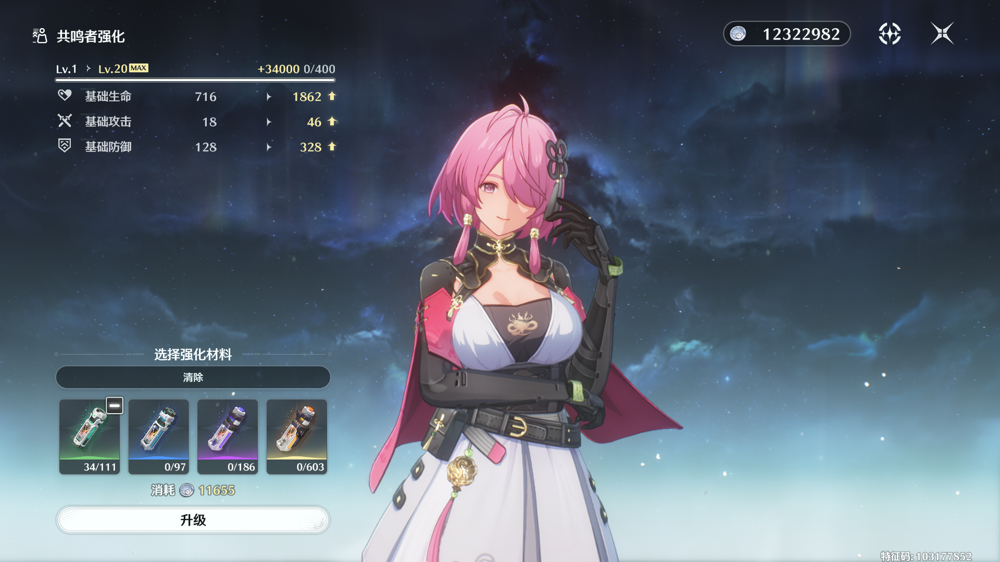

角色等级上限为 90 级，突破以阶段节点打开后续上限；经验推动等级，突破调用贝币、敌人材料、区域采集物及相应挑战材料。作用是把成长分成玩家看得懂的、付出时间和精力就有回报的正反馈目标。这个系统适合承担前期的确定性反馈。声骸强化可能失败，但经验和突破材料投入后，进度不会倒退。对刚获得角色的玩家，这是一种很重要的确认感：今天做的事情确实让角色更接近可用。

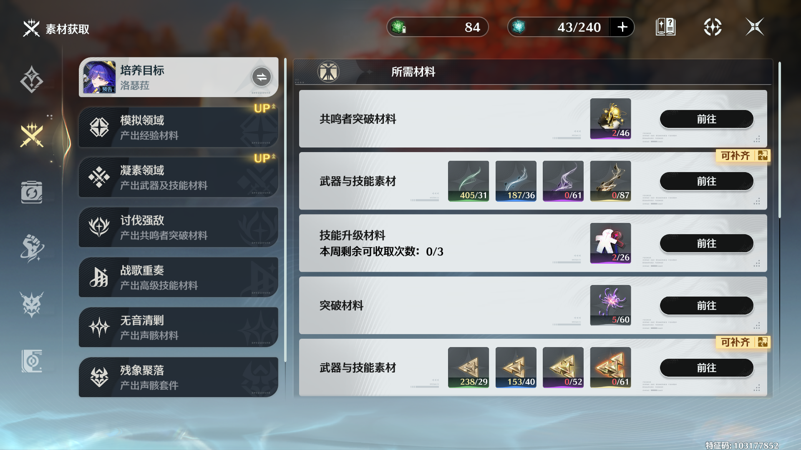

不同来源的素材又把角色养成引向不同内容。区域采集让角色与地点建立联系，讨伐强敌和战歌高奏材料让玩家接触对应战斗，通用经验和贝币则保留提前准备的空间。这里同时存在“角色属于这个世界”和“玩家能够自主规划”两种需求。

问题在于，前期的引导路线会在重复养成时变成摩擦。第一次寻找特产可以帮助认识区域，第十次沿同一路线采集，价值就主要是材料。对于成熟账号而言，基础材料采集不应继续成为重复消耗时间的负担，而应提供更便捷的资源追踪、定向获取及兑换途径。值得肯定的是，《鸣潮》在这一点上已经有了明显进步：从开服初期采集辅助功能相对匮乏、玩家需要频繁查找攻略和往返跑图，到如今逐步完善的材料追踪与采集便利化设计，资源获取过程中的无效操作和时间成本得到了有效压缩。

从养成体验看，这一变化可视为养成系统设计思路趋于成熟的体现：采集本身并不需要始终保持高操作成本，尤其当玩家已经熟悉世界与资源分布后，系统更应该服务于养成目标的高效达成，而不是反复要求玩家完成早已掌握的基础劳动。这种减负既保留了新玩家探索和认识世界的过程，也让老玩家能够把更多时间投入角色构筑、战斗体验和新版本内容中。

### 技能成长：玩家应该为有效动作投入，而不是平均填满界面

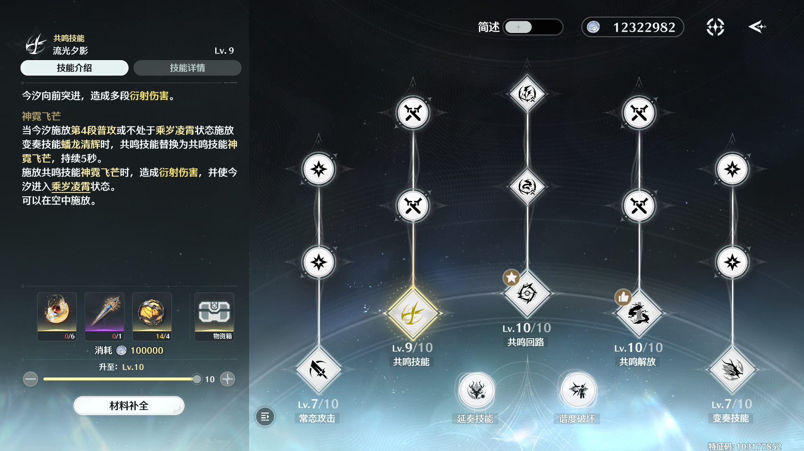

常态攻击、共鸣技能、共鸣回路、共鸣解放、变奏技能构成五条主要技能升级线，最高到 10 级，另有固有技能和属性分支。真正决定升级优先级的是实战中的伤害归属、功能收益和使用频率。[\[0\]](#ref_0)

这一设计允许角色在相同操作框架下拥有不同成长重点：有的角色依赖解放窗口，有的把主要伤害放在回路派生动作，有的更重视其他伤害模块。玩家读懂角色后，可以少投入一些暂时没有价值的项目，较早进入队伍。

因此，技能树应明确告诉玩家“点这一级会改变什么”。倍率提高与机制解锁是两种不同的体验。前者通常表现为数字上涨，后者可能让循环完整、治疗稳定或触发方式改变；关键机制节点理应拥有更高的说明优先级。

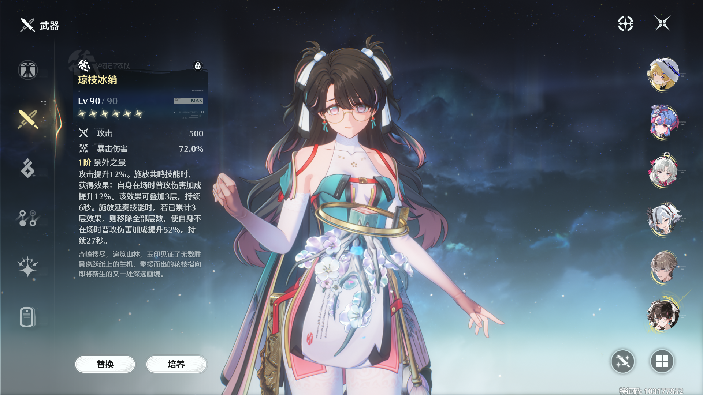

同时，鸣潮的动作派生和伤害归类有时并不等同于按键。例如折枝的专属武器通过共鸣技能与延奏建立条件，最终强化的可以是普攻伤害。这意味着“经常按技能键”不等于“应该优先堆共鸣技能伤害”。[\[8\]](#ref_8)

“技能说明的信息量与玩家实际理解效率之间存在明显落差”

《鸣潮》的角色技能设计具有较高的机制复杂度，尤其是部分新角色，其技能涉及多种攻击形态、特殊资源、状态转换、伤害判定及队伍协同条件。这些内容往往被集中写入篇幅较长的技能说明中。虽然文字描述能够保证机制规则的完整性，但从玩家实际使用的角度来看，说明得足够详细，并不意味着玩家就能够快速理解。

在本文记录的个人游玩体验中，即使已经长期接触《鸣潮》的战斗与养成系统，仅凭部分新角色技能界面的文字说明，仍难以迅速建立对其完整输出逻辑的认识。该体验也提示，新玩家可能面临更高的理解门槛。玩家可能只知道某个技能具有多少倍率、需要消耗什么资源，却不清楚它对应的是哪一段实际动作、应该在什么时机释放，以及如何与其他技能衔接。

这也导致了一个值得关注的现象：游戏内技能界面在实际体验中更像是角色养成时的一次性升级界面，而不是帮助玩家持续学习角色机制的教学工具。 在上述个人体验中，技能界面的主要使用场景集中在抽到新角色后的技能升级阶段；角色的输出手法、技能衔接、关键伤害来源、配队逻辑以及不同共鸣模态下的操作变化，则更多通过外部攻略和实战视频理解。

这一体验反映出，问题并不单纯在于玩家阅读意愿，也在于技能说明的信息组织方式与玩家认知需求之间存在一定错位。玩家理解一个技能，通常需要依次回答三个问题：这个技能会做什么、触发条件是什么、触发之后能获得什么收益。 现有的长篇文字说明主要承担规则定义和数值查询功能，却缺少将抽象机制转化为实际战斗行为的直观表达。

因此，建议借鉴《英雄联盟》在技能展示方面的设计思路，在《鸣潮》现有技能说明界面中增加一个可自主播放的短时技能演示动画，并针对不同技能设置更加直观的机制说明。

具体来说，演示不应只是播放一段角色释放技能的视觉效果，而应围绕输入条件—执行动作—输出结果组织信息。例如，先通过按键图标及状态提示展示技能的触发条件，再通过角色动作演示具体的攻击形态、影响范围和技能衔接，最后用简短标注说明造成的伤害类型、获得或消耗的特殊资源，以及对后续战斗循环产生的影响。对于存在多段派生、特殊触发条件或不同共鸣模态的技能，还可以分段展示关键变化，避免玩家必须观看完整连招才能找到自己想理解的部分。

在交互设计上，演示动画不宜设置为进入技能界面后强制播放。玩家应能够自主选择播放、暂停或重复观看，默认保持现有技能说明的正常阅读体验。文字说明仍然保留完整的规则和数值信息，动画则作为额外的理解辅助，两者形成互补，而不是用简单演示替代复杂机制。

这一改动的价值不仅在于降低新玩家的学习门槛，也在于重新建立技能界面与实际战斗之间的联系。玩家在角色养成阶段，可以通过动画判断哪些技能值得优先升级；在学习输出手法时，可以反复查看关键技能的触发与衔接；在更换队友、武器或共鸣模态后，也能够重新理解角色机制及其使用方式。

从系统策划角度来看，这实际上是在打通原本相对割裂的三个环节：技能规则认知—角色养成决策—战斗操作实践。 当玩家能够直观理解技能效果与实际收益之间的关系时，技能升级就不再只是照着攻略点击推荐节点，而是基于自身队伍构筑与战斗需求作出的主动选择。

这套方案还需考虑开发成本。《鸣潮》的角色动作复杂、技能派生较多，如果要求所有技能都制作独立的高规格演示，会增加动画制作与后续版本维护负担。因此，建议优先复用已有战斗动作与特效资源，对核心技能、特殊资源机制和容易引发误解的派生动作制作短片段演示，而非对每一段数值描述都单独制作动画。

设计目标是让玩家在游戏内部就能完成对角色核心机制的初步理解，再通过实际战斗逐步掌握更深层的操作技巧。 外部攻略依然可以承担高阶配队、极限输出与进阶机制研究的作用，但不应该成为玩家理解角色基础技能的必要前提。

从长期运营角度看，这种设计未必会直接提升日活或收入，但有望缩短新角色从获取到有效使用的时间，提高玩家尝试不同角色和队伍的意愿，并降低复杂角色带来的学习挫败感。其实际效果可以通过新角色获取后的首次有效使用时间、技能演示使用率、角色试用完成率及后续持续使用率等指标进行验证。

### 周本：限制高阶成长速度

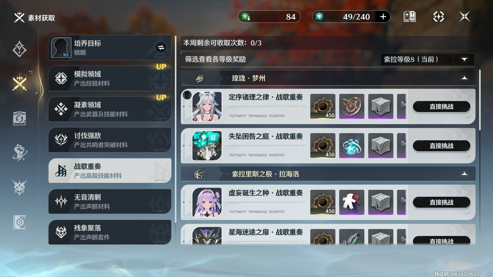

周本奖励每周有三次领取额度，部分高阶技能需要对应材料。它与普通体力材料的区别，是不能仅靠当日继续消耗体力无限补齐。这可以把后段成长分散到多个自然周，让同一首领有持续回访价值。

### 贝币、通用素材与专属材料：共用资源并不都应当互通

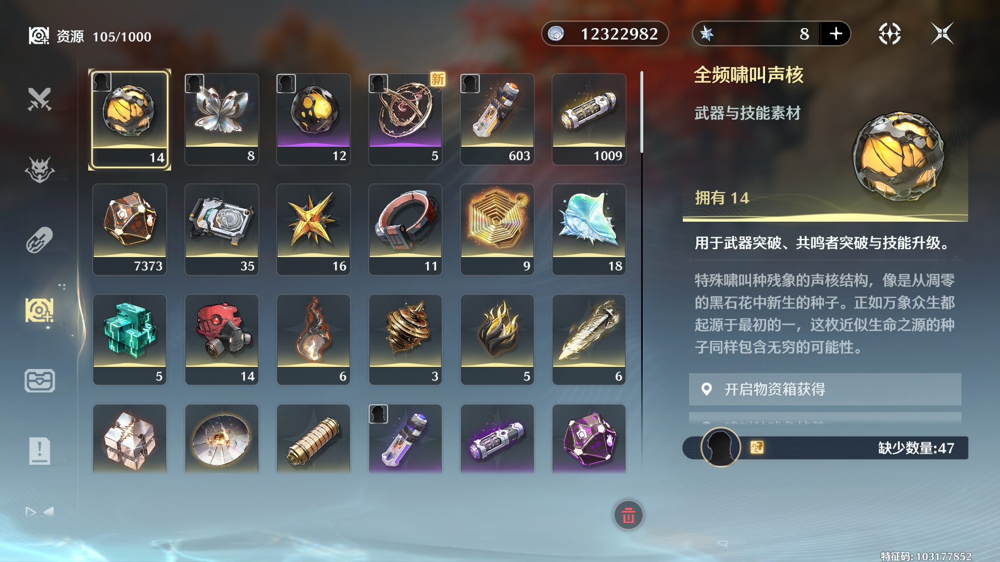

贝币在多条成长线上通用，相当于给所有养成项目增加一层共同预算。它让玩家不能完全忽略投入顺序，也使活动奖励在不同账号阶段都可能有用。但当贝币与经验、技能材料同时短缺时，玩家容易先看到目标材料已齐，再被另一项通用成本拦下。

专属素材则保留地区和角色身份，也减少老账号仅靠旧库存跳过全部新内容的可能。完全通用会削弱新内容的引导作用，完全不通用又会提高回流和追赶成本。给基础上场提供有限的通用缓冲，同时保留后段成长的内容归属。

### 联觉等级与索拉等级

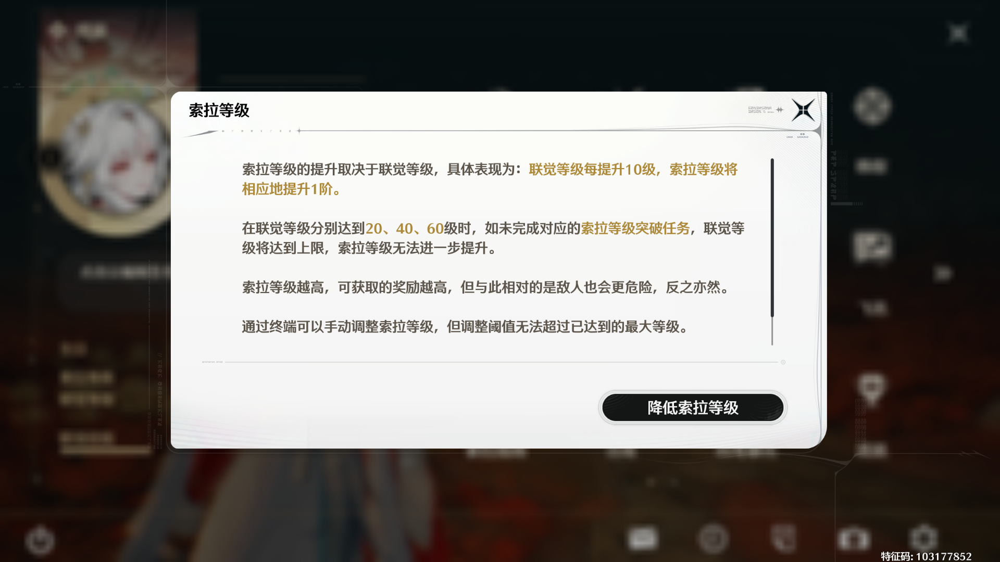

联觉经验来自日常目标、波片消耗、任务与探索等行为，并推动更多内容解锁；索拉等级提高，则让部分奖励的数量和品质提高，同时增加敌人的危险程度。这两条规则把账号推进、资源效率和日常战斗难度连在一起。[\[13\]](#ref_13)正向循环是：玩家培养角色、完成内容，账号推进后又获得更高资源效率，可以支持更多培养。风险在于，账号进度并不等同于整支队伍的成熟度。玩家可能通过较广泛的探索推进了账号，却把有限资源分散在太多角色身上；难度上升后，会感到“明明升级了，反而更吃力”。这种落差应在阶段提升前被解释。提示不能只说敌人更强、奖励更好，还应帮助玩家检查常用队伍的关键突破、必要技能与可用装备，让进入新阶段成为有准备的选择。账号级成长应该放大过去的投入，而不是突然暴露一笔没有预告的补课成本。

## 三、武器、声骸与共鸣链：三条线的分工

### 武器：相对清晰的补强目标

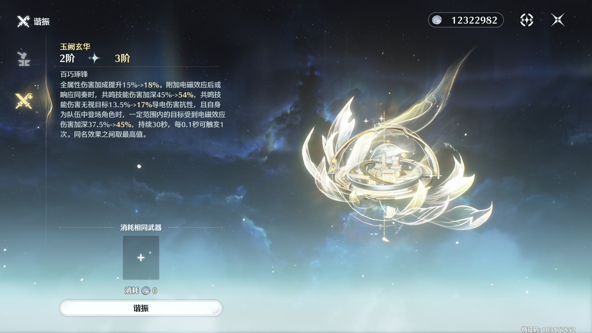

武器把基础属性、次级属性与被动效果集中在同一件装备上，等级成长和重复获取的谐振成长又分别对应常规培养与更深投入。[\[0\]](#ref_0)[\[8\]](#ref_8)

角色与武器分开获取，给玩家保留了两个不同决策：先扩大角色池，还是强化已经喜欢的角色。[\[7\]](#ref_7)从系统设计上看，较确定的武器目标适合接在角色获取之后。玩家已经知道角色的动作和队伍需求，再决定是否补足武器，比在第一次获取时承受所有随机更容易规划。对不继续投入的玩家，通用武器也应能支持基础玩法，而不是仅在背包里占一个“替代品”位置。同时，武器需求的必要性会被社区推荐、试用配置和高难基准共同放大。如果展示与验证长期默认角色加专属武器，玩家就可能把原本可选的补强理解成基本完成条件。此时“武器不歪”的善意仍然存在，但完整使用价格上升了。

应该同时看专武获取率与无专武角色的使用率。前者增长、后者稳定，可能说明补强有吸引力；前者增长、后者持续下降，则需要检查是不是基础体验被推高了门槛。

### 武器与声骸不是两次加法，而是相互改变最优分配

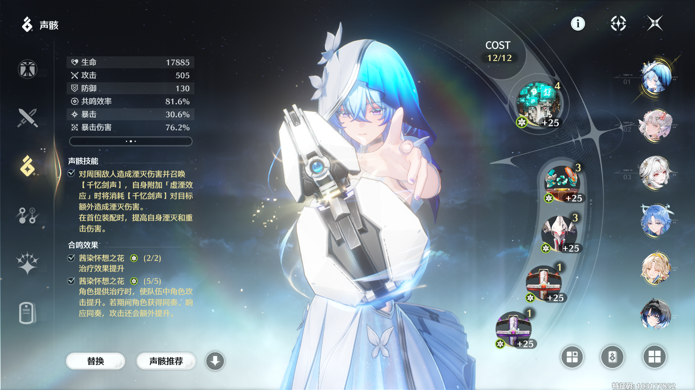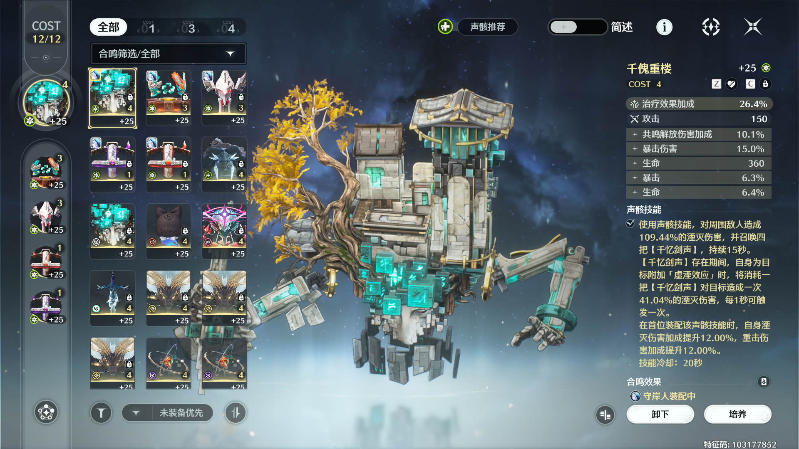

当武器提供暴击率时，声骸主属性和副属性的选择可能改变；当武器补足共鸣效率时，原本用于维持循环的词条可以转向输出。反过来，一套较好的现成声骸，也可能降低为新角色再获取某类武器的紧迫性。

在《鸣潮》中，同样的属性增加，对不同当前状态的收益不同。已有同类加成越高，再增加同类加成的相对增幅通常越小；而从“第二轮无法开解放”跨到“每轮都能开”，收益可能是跳跃式的。

### 声骸首先是一套构筑预算，而不只是随机词条容器

每名角色配置五个声骸槽位，COST 预算、声骸技能和合鸣效果共同约束配装。常见的 4+3+3+1+1 使用 12 点 COST，4+4+1+1+1 使用 11 点。[\[0\]](#ref_0)五个槽位让玩家无法无限叠加高价值效果，COST 又把不同档位的属性池放进同一预算。于是配装需要同时考虑主属性、合鸣生效条件、首位声骸能力和现有库存，而不是只比较每一件的单项分数。首位声骸尤其重要。它把装备接进动作循环：施放时间、位移、变身或召唤形式、能否安全释放、是否适合当前敌人，都会影响实际价值。一个纸面增益更高、但经常打断操作节奏的声骸，不一定是玩家更好的选择。这种设计使角色的“第五项能力”部分来自世界中的敌人，具有辨识度，也给动作体验提供了额外变化。

### 数据坞：把收集兴趣转为账号级成长

数据坞让声骸收集与掉落品质成长关联起来。它不是只服务某个角色的装备表，而是一条跨角色、跨区域积累的账号进度。3.0 官方公告继续调整数据坞及声骸相关能力，说明这条线也承担版本扩展的接口。[\[2\]](#ref_2)[\[0\]](#ref_0)

前期，收集新品种同时带来图鉴完成和产出能力提升，能把“第一次遇见一种敌人”变成更明确的收益。角色养成因此不必全部发生在副本选择界面，玩家有理由去认识世界里的不同敌人。进入成熟阶段后，数据坞的意义会变化。玩家关注的不再是每次收集的知识，而是如何更快拿到目标品质。

### 胚子可通过大世界获取，强化资源却要预算

声骸的一个关键特点，是大世界战斗可以提供胚子，而强化和调谐仍受到材料预算约束。3.0 的残象聚落明确提供不消耗结晶波片的声骸获取渠道，但这不等于完整成品装备没有时间或资源成本。[\[2\]](#ref_2)这两道门分别服务不同需求。胚子获取提供“今天还可以多做一点”的主动空间；强化资源控制成品进入速度，防止有大量在线时间的玩家无限拉开差距。对内容消耗快的玩家，前者也给大世界保留了回访理由。

但它会制造一种容易被低估的库存体验：玩家已获得大量看起来值得培养的声骸，却没有足够资源验证它们。背包里的“机会”越多，未完成事项也越多。所以需要同时展示两种进度：有没有合适的候选，以及有没有能力把候选培养到验证阶段。只提高胚子产量、不给筛选和强化预算解释，可能减少缺货感，却增加管理负担。系统优化必须看整条加工过程，而不能只看掉落数。

### 分段强化与调谐：随机性如何从养成动力转变为体验负担

《鸣潮》的五星声骸最高可强化至25级，每提升5级便可解锁一个副属性调谐阶段，最终获得五条副属性。与一次性生成全部词条的装备系统不同，这种分段揭示的方式，让玩家能够根据已经出现的词条判断是否继续投入资源。从参与决策的角度看，这套设计的价值不只在于控制资源消耗，也在于让玩家在养成过程中持续参与决策。 玩家不需要在完全未知结果的情况下支付全部培养成本，而是可以先投入少量材料，通过前一两条词条判断声骸的培养潜力，再决定是否继续强化。对于具有一定游戏理解的玩家而言，判断一件声骸是否值得继续培养，本身就是角色构筑的一部分。这种机制同时建立了比较明确的期待反馈。每次调谐都可能获得理想词条，使玩家产生继续投入的动力；即使当前结果不够理想，也可以选择及时停止，将资源转移到其他声骸上。因此，在养成前期，分段强化既提供了随机掉落的惊喜，也赋予了玩家一定的资源规划空间。

但随着账号养成程度不断提高，这套机制的体验会发生明显变化。首先，分段揭示虽然赋予了玩家中途止损的机会，却也可能放大沉没成本效应。例如，一件声骸的前几条副属性都比较理想，只差最后一条就可能成为高质量装备。此时，玩家往往更愿意继续强化，因为放弃意味着此前投入的材料没有换来预期中的最终成果。即使最后一次强化的预期收益并不理想，玩家仍可能因为不愿放弃已有投入而继续尝试。这一点在单件声骸上未必会造成明显问题，但当玩家不断经历类似的强化过程时，原本用于制造期待感的机制，就可能逐渐转化为持续的心理负担。其次，成熟账号的养成目标发生变化后，随机性带来的正向反馈会显著减少。在游戏前期，玩家的声骸配置尚未成型，即使副属性并不完美，新装备也有较大机会带来实际战力提升。因此，玩家通常能够比较频繁地感受到养成成果。但对于已经拥有多套成熟声骸的玩家而言，培养目标不再是获得一件能用的装备，而是进一步优化已有配置。由于原有声骸的质量已经较高，新声骸必须满足更严格的属性条件才有替换价值。这意味着，随着角色练度提高，玩家需要投入的资源可能不断增加，但获得有效提升的频率却逐渐下降。

从本文记录的个人游玩体验看，声骸养成最容易产生挫败感的情况，并不是某一次强化没有出现理想词条，而是连续多天投入资源后，角色配置依然没有任何实质变化。玩家明明完成了日常资源获取，也投入了强化和调谐材料，却无法判断自己究竟距离目标更近了多少。这种体验的核心问题，是玩家的资源消耗具有确定性，而成长反馈却缺少相应的可预期性。随机性本身并不是问题。对于需要长期运营的角色养成游戏而言，具有一定随机性的装备系统能够延长养成周期，为成熟账号提供持续追求的目标，同时维持日常资源消耗的需求。因此，系统需要区分两种不同的养成需求：一种是让新角色尽快形成可用战力，另一种是让成熟角色持续追求更高的属性上限。前者更需要确定性的成长保障，后者才适合保留较长的随机追求周期。如果两者始终依赖同一套高度随机的培养过程，就可能导致新角色培养成本过高，而成熟角色又长期无法获得有效提升。

同时声骸养成并不是独立存在的装备系统，其体验还会进一步影响角色获取、队伍构筑以及游戏的长期运营。从角色获取来看，玩家决定是否抽取新角色时，考虑的不只有抽卡成本，还包括后续培养所需的时间和资源。当玩家对声骸培养有较好的预期时，获得新角色意味着开启新的战斗玩法和队伍构筑方向，能够进一步激发培养兴趣。但如果玩家已经积累了较多尚未完成养成的角色，或者对声骸强化产生了明显的疲劳感，那么新角色即使具有吸引力，也可能因为后续培养成本而降低抽取意愿。从日活角度来看，随机养成可以通过持续的资源需求推动玩家登录、刷取声骸并消耗体力。但持续登录并不必然意味着玩家对养成系统保持着正面评价。如果玩家长期无法获得有效提升，日常资源获取就可能逐渐从主动追求成长，变成担心浪费体力和资源而进行的重复劳动。短期内，这种机制仍可能维持一定活跃度，但长期来看，玩家可能降低声骸刷取频率，减少新角色培养，甚至逐渐失去继续登录的动力。从商业化角度来看，声骸培养带来的影响则更为间接。玩家对新角色的付费意愿，不仅来自角色本身的吸引力，也与其是否相信自己能够顺利完成培养有关。如果获取角色之后仍需要经历漫长且难以预测的装备培养过程，那么玩家可能倾向于减少新角色获取，将现有资源集中投入已经成型的队伍。这里并不能直接得出“声骸随机性越高，游戏收入越低”的结论，但可以提出一个值得验证的判断：当角色的后续培养成本逐渐成为玩家获取新角色的顾虑时，装备养成系统就可能开始对角色商业化产生反向约束。

评价声骸养成系统的随机性是否合理时，不应仅使用某个理想词条组合的毕业概率来判断随机机制是否合理。一方面，不同角色对副属性的需求并不相同，玩家对“有效声骸”的判断也存在差异。对于刚开始培养角色的玩家而言，满足主要属性需求便可能形成明显提升；对于成熟账号而言，同样的词条组合可能完全没有替换价值。另一方面，声骸的合鸣、主属性、副属性以及已有的定向获取和重构手段，都会影响实际培养成本。简单将多个随机概率相乘，容易忽略玩家在获取和强化过程中的主动选择，也难以准确反映真实养成体验。因此，建议从玩家实际成长过程出发评价这一系统，重点关注三个方面：

有效提升的等待时间： 玩家从开始培养到首次获得符合当前需求的声骸，需要消耗多少时间和资源。

连续投入无收益的情况： 在一定周期内，玩家可能经历多少次强化失败，以及这些失败是否具有可利用的资源回收价值。

养成进度的可预期性： 即使玩家暂时没有获得理想词条，是否仍能通过其他机制逐步接近培养目标。

尤其需要关注长期未获得提升的玩家，而不是只统计已经完成养成的账号。否则，体验最差的一部分玩家可能因为尚未达到目标而被排除在统计结果之外，最终低估随机机制所造成的挫败感。

值得肯定的是，《鸣潮》已经通过声骸定向获取、属性重构等机制，为玩家提供了不同程度的随机结果纠偏手段。3.1 官方公告确认新增定向融合和辅音属性重构，并支持主音属性批量重构；3.7 官方更新记录确认支持声骸堆叠存储。[\[3\]](#ref_3)[\[1\]](#ref_1)

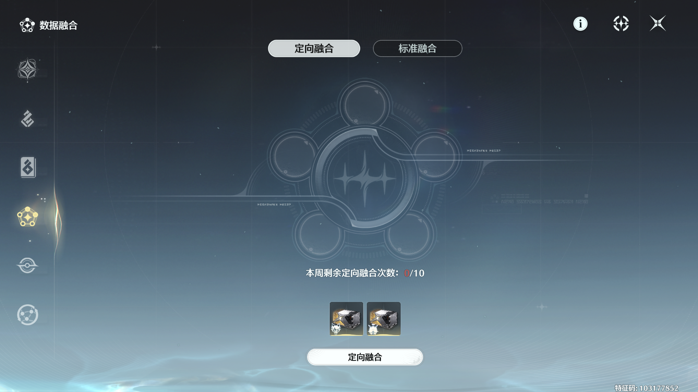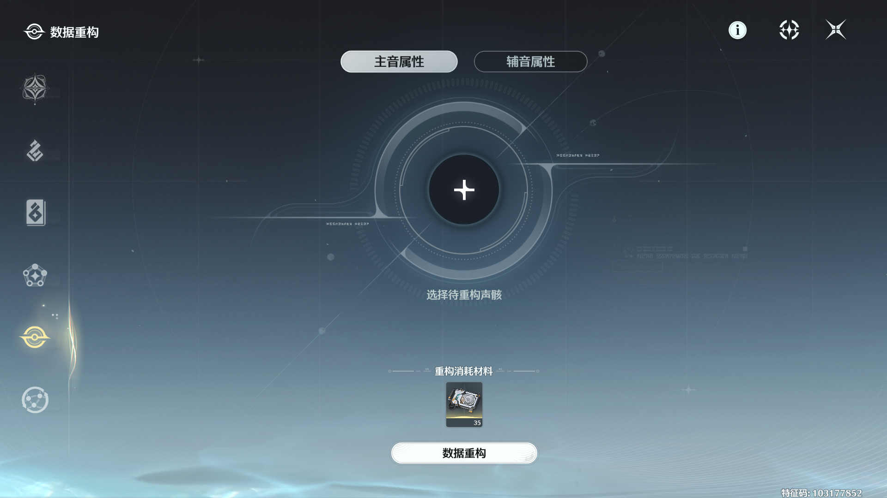

辅音重构允许保留部分属性，并选择是否接受新结果。它在设计上保护了已经获得的好属性，让“差一点”的装备不必完全报废。锁定更多属性需要更多资源，又保留了后段精修的消耗空间。[\[3\]](#ref_3)这些改动说明后续演进可以分层做，不必在“全部保底”和“完全随机”之间二选一。

| 能力 | 直接缩小的成本 | 没有直接解决的部分 |
| --- | --- | --- |
| 定向融合 | 寻找目标合鸣的筛选范围 | 主属性、后续调谐、强化资源 |
| 主音重构 | 候选声骸主属性不合适 | 副属性、循环适配、队伍需求 |
| 辅音重构 | 已培养装备的后段纠偏 | 入口条件、消耗与仍然存在的随机 |
| 堆叠与管理 | 重复胚子的占格和处理操作 | 成品获得速度、有效属性概率 |

同时，上述机制表明声骸养成并非完全依赖重复刷取，而是在逐步增加玩家对培养结果的控制能力。基于文中记录的个人体验，成熟账号的养成需求更应重视长期投入的累积价值，而非每次强化都必然获得理想属性。建议保留声骸随机养成的核心结构，同时进一步完善失败后的资源回收与目标修正机制。例如，为持续消耗资源却未获得有效提升的玩家提供一定的定向调整机会，或者让部分无效培养结果能够转化为后续养成所需的资源（不只是作为经验材料）。这类设计并不一定会显著缩短极限毕业周期，却能够让玩家在没有获得理想词条时，依然感受到自己的投入并非完全无效。

从系统策划角度来看，声骸养成真正需要平衡的不是随机性与确定性孰优孰劣，而是不同养成阶段应该承担多大的随机成本。基础成型阶段应尽量保证成长效率，让玩家能够尽快体验新角色的核心战斗机制；中期培养阶段可以通过分段强化与资源规划保留一定决策空间；而极限精修阶段则可以保留更高的随机性，为深度玩家提供长期追求。只有让不同阶段的玩家都能获得与自身投入相匹配的成长反馈，声骸系统才能真正成为推动角色培养、队伍构筑与长期游玩兴趣的正向循环，而不是在不断延长养成周期的同时，逐步消耗玩家继续投入的意愿。

### 共鸣链：深投入必须区分数值、舒适度与玩法改变

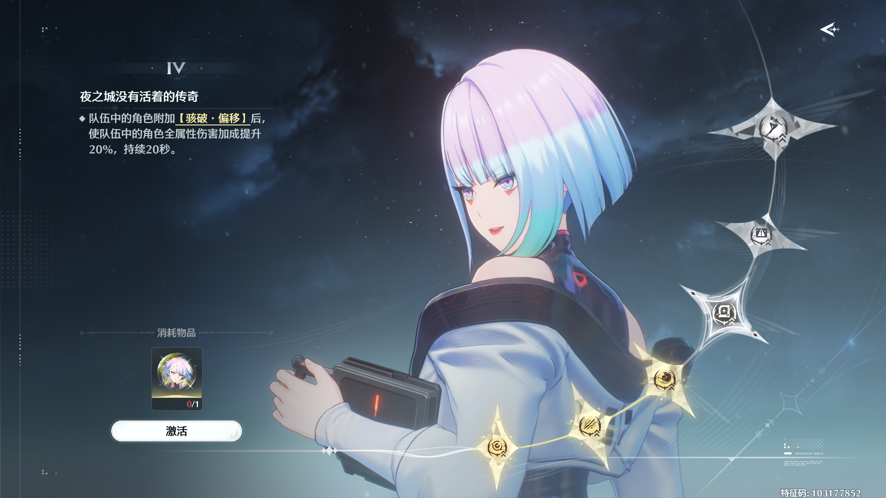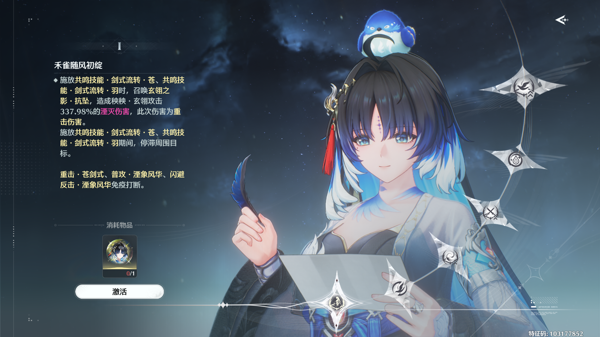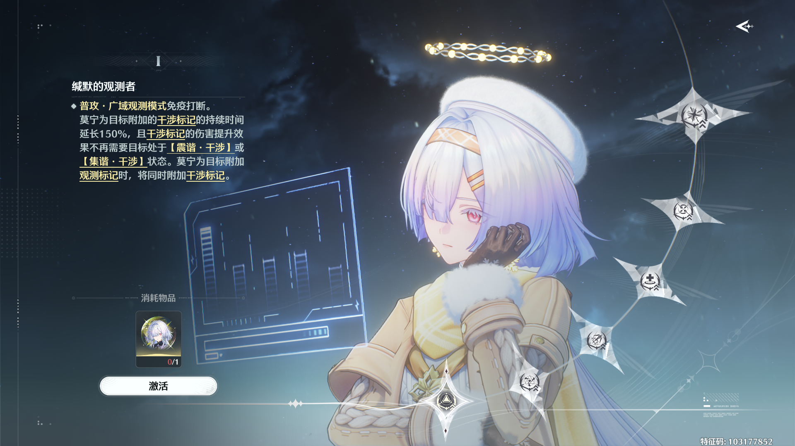

共鸣链包含六个节点，通过角色专属的重复获取资源逐步解锁。它与日常材料成长不同，主要承接更深的角色投入。节点可能增强伤害、补足能量、提高容错或改变操作体验。[\[0\]](#ref_0)[\[8\]](#ref_8)[\[9\]](#ref_9)链位可从数值、舒适度与机制三类价值进行评估。纯数值节点增加输出余量（对应露西的图片）；舒适度节点降低循环或操作成本（对应秧秧的图片）；机制节点改变角色在队伍里的工作方式（对应莫宁的图片）。最需要谨慎的是把体验修复放进付费深度。如果零链的主要循环本来完整，高链让它更灵活，玩家感到的是强化；如果零链持续存在让人不适的断档，高链恰好消除，玩家可能感到自己在为缺陷补票。区别不在节点文字是否写了“伤害提升”，而在零链能否独立兑现角色的核心玩法。珊瑚兑换提供了重复获取之外的确定性通道，但仍占用具有其他用途的抽取副产物，不是没有机会成本的赠送。[\[0\]](#ref_0)

### 一个具体例子：今汐二链为什么不能只折算成统一提升率

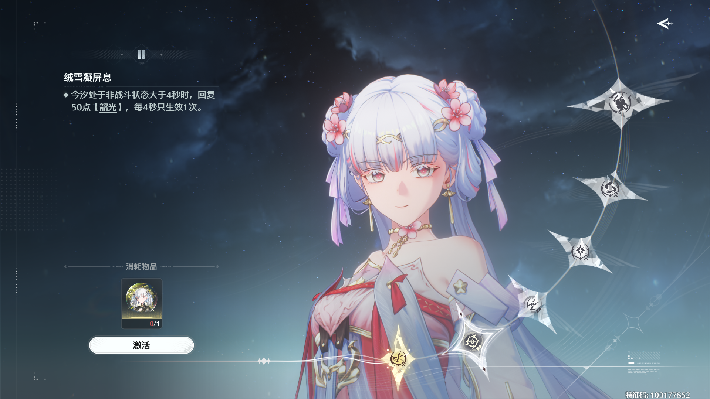

今汐二链可在满足非战斗时间条件后回复韶光。这个效果首先改变的是战斗开始时的资源状态，而不是无条件给所有伤害乘上同一个系数。[\[9\]](#ref_9)对大世界的短遭遇战，它可能让玩家更快进入有满足感的爆发，减少每次小战斗前的准备。玩家感受到的价值，是喜欢的角色在随手清怪时也能更直接地发挥，而不只是结算数字更高。对长时间连续战斗，它的价值更多集中在符合条件的起手或重新进入战斗时。对会清空或重设状态的特定玩法，还必须按实际入口规则重新测试。

这个例子说明，角色养成的价值必须回到使用情境。一个链位可能对日常舒适度很重要，却不能用统一的持续 DPS 提升率描述；一个纯倍率节点可能对竞速很有效，却未必让探索体验同样明显。

## 四、内部耦合：培养一支能运转的队伍

### 先看队伍产出，再解释个人面板

三人队伍的实际表现，取决于每个角色做了什么、占用多久、触发了什么，以及这些动作是否在敌人的有效受击窗口内完成。把一次循环拆成输出、资源生成、增益、治疗保护与状态处理，再检查它们发生的时间。辅助自己的伤害不是零，部分动作可以与离场角色的演出重叠，主输出也可能正在等冷却。因此，用“增益强度÷站场时间”作为辅助强度公式，并把多站场的每一秒都算成主输出损失，并不准确。更合适的比较是：替换一个位置后，在相同战斗条件下，全队完成一轮的伤害、用时、成功率和容错发生了什么变化。少站场有价值，但前提是省出的时间真正变成有效输出，或者降低了操作风险。

队伍有效输出效率 = 同一观察窗口内实际造成的伤害 ÷ 该窗口耗时。比较时还必须记录阵亡、断档、重试和敌人状态，不能只取最理想的一轮。

### 内部耦合矩阵：投入为什么经常不能单独评价

| 模块关系 | 相互作用 | 玩家的可感知结果 | 需要防范的副作用 |
| --- | --- | --- | --- |
| 等级／突破 × 技能 | 开放上限与关键节点，基础属性支撑技能收益 | 一次突破后可以完成新的成长阶段 | 等级提升看似完成，功能仍被另一节点卡住 |
| 武器 × 声骸 | 共同分配输出、共鸣效率与被动条件 | 同一角色可以形成不同配装方案 | 推荐忽略现有装备，诱导重复建设 |
| 声骸 × 技能回路 | 属性与合鸣服务实际伤害归类和资源循环 | 不只数字高，循环也更顺 | 面板评分高，关键能量仍不足 |
| 延奏／变奏 × 队友 | 把切换、增益与登场条件连接起来 | 操作顺序正确时有明确收益 | 增益太窄，让替代队友难以上场 |
| 共鸣链 × 循环 | 改变起手、能量、容错或爆发强度 | 同一角色出现更舒适或更深的用法 | 把基础机制完整性放入深度付费 |
| 通用资源 × 多角色 | 同一预算在不同成长目标间分配 | 玩家选择先补强还是先扩队 | 未完成角色过多，新增角色变成负担 |
| 装备／队友复用 × 多队要求 | 一份投资可能支撑多支队伍，也可能被同时出场限制 | 旧资产降低尝试新阵容的成本 | “能组很多队”却不能同时完成多队挑战 |

这不是一个所有模块都越强越好的乘法游戏。玩家常遇到的是阈值：能否按时释放解放、能否覆盖关键爆发、能否活到下一轮、能否在限时结束前多打一轮。某一项跨过阈值，可能比多个面板属性的小幅提高更重要。

### 共鸣效率的价值，是让既有投入反复生效

两套示例配置：A 每轮造成 1000 个任意伤害单位，但因为资源不足，每轮要 24 秒；B 为共鸣效率牺牲部分面板，每轮造成 950 单位，却能稳定在 20 秒完成。效率分别约为 41.7 与 47.5，B 高约 14%。这说明一个看起来“不直接加伤害”的词条，可能通过缩短空档，提高武器、技能等级和其他增益的兑现频率。但也不能反过来无限堆共鸣效率：当循环已经稳定，再增加这一项就可能挤占更有价值的属性。

玩家主观上的变化通常比面板更明显。第一种配置可能第一轮很亮眼，第二轮却频繁等待；第二种配置单次数字略低，但每一轮都按预期发生。对长期游玩，可靠的反馈更容易形成熟练感。因此，角色面板推荐应把“循环满足条件”放在评分之前。队友变化、敌人数量变化、击杀产能变化，都可能让原本刚好够用的效率失效。

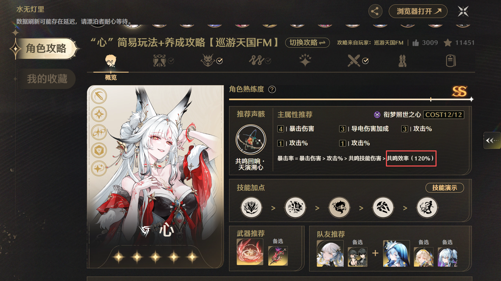

### 延奏与变奏：有方向的接力

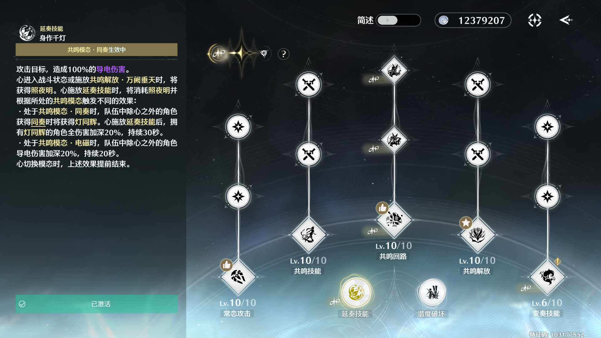

协奏充满后的切换能够触发相应延奏与变奏，这让“离场”本身也提供价值。但不同角色的延奏效果、持续方式和失效条件并不完全相同。[\[0\]](#ref_0)[\[2\]](#ref_2)有下一位限定的效果，就会强化顺序决策；持续的团队效果，则给中途调整留下空间；离场伤害和协同效果，又可能让两个角色在同一时段持续贡献。它们共同决定队伍是接力型、轮切型，还是围绕特定资源管理形成的变体。从玩家体验看，接力明确的好处是反馈清楚：前一个动作确实帮助了后一个角色。风险是偏离固定顺序后，玩家可能不知道自己丢了什么。如果一次紧急闪避或换人生存让大部分增益消失，错误成本就可能高于界面表现出来的程度。

### 一个具体例子：从谐度破坏增幅到下一位角色的装备收益

3.0 的「逆光跃彩之约」把装备效果挂在延奏接力上，并让下一位角色的谐度破坏增幅参与攻击收益计算；切到其他角色又会提前结束相应效果。[\[2\]](#ref_2)

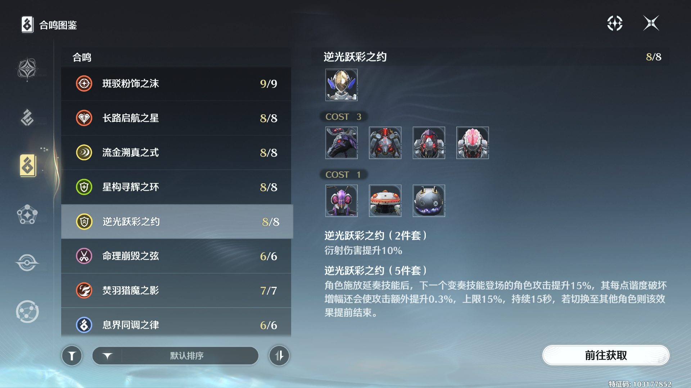

这个细节同时耦合了四个模块。第一，穿戴者需要以延奏完成交接；第二，接收者需要通过变奏登场；第三，接收者的某项战斗属性会影响收益；第四，后续切换会影响覆盖时间。装备因此不只是“某人穿哪套”，而是在规定一段队伍协作方式。

它带来的正面体验，是玩家能通过正确的资源准备与出场顺序，把几条规则组合成一次更有力的输出。角色养成的结果不再只是进入战斗前的静态面板，而会在实际操作中被激活。但这种设计也使错误诊断更复杂。玩家换了模态、换了接收者，或者为躲避攻击提前切人，收益都可能不同。

### 共用辅助：单队的高效率，可能成为多队的瓶颈

泛用辅助能服务多名输出角色，降低账号后续养成成本，也更容易成为玩家长期保留的资产。但当高难内容需要多支不能共享角色的队伍时，这个优点会转化为配置冲突。假设玩家拥有三名已培养的主输出，但三套理想方案都依赖同一个辅助。账号看起来有三支队伍，实际同时可用的方案却不足三支。下一次有价值的投入，未必是第四个输出角色，而可能是一个功能不同的替代辅助。这也解释了为什么角色池宽度不能只看已拥有或满级人数，而应该是在具体出场限制下，能组成多少支不冲突、循环成立且达到目标要求的队伍。装备是否可以跨场复用，也应按玩法规则单独判断。从经营角度推断，良好的替代辅助能同时提高旧输出的使用价值和新辅助的需求；过度唯一的辅助则可能让玩家把后续抽取看成配队税。

### 边际投入

资源分配可以按当前短板排序，但不宜给所有账号一条恒定优先级。若队伍频繁阵亡，增加生存和操作容错可能比提高暴击更有效；若循环缺能量，应先修循环；若只差少量伤害跨过限时门槛，确定性技能提升可能比继续抽随机词条可靠。

另一类值得投入的是账号层面的复用。培养一个适配多队的功能角色，单队的即时提升可能不如专武明显，却可以降低之后每个角色的上场成本。它的收益需要放到多支队伍和多个版本里看。

## 五、外部耦合：角色价值如何跨过版本边界

### 与战斗的双向关系

技能设计决定有效属性，敌人行为决定属性能否兑现，玩法目标又决定玩家追求稳定通关还是极限效率。养成没有脱离场景的绝对收益。例如，爆发窗口短的敌人会提高起手与瞬时输出价值；频繁移动的敌人会提高追击、索敌和输出容错的重要性；多波小怪可能奖励启动快与对群能力。它们不需要改变角色面板，就能改变玩家的培养选择。

这提供了成本较低的内容变化手段，也增加了平衡责任。环境可以奖励新玩法，但若每次都让旧方案的关键环节难以触发，玩家仍然会感到资产贬值。角色数值没有改，不代表玩家实际拥有的价值没有变。

### 与探索和剧情的耦合

角色材料和声骸分布把养成需求带到世界中，玩家有了回到某个区域的具体理由。剧情又能给这次回访增加意义：玩家不仅在地图上寻找材料，也在与角色所在的世界持续建立联系。

冲突出现在最新角色和历史内容之间。新玩家被当前角色吸引，却发现关键材料入口在尚未解锁的区域，就可能从主动追剧情转为跳过剧情赶进度。此时养成没有促进内容消费，反而改变了消费方式。因此，3.0 官方公告提供了新地区剧情快速体验入口，并保留原有任务进度，这为内容顺序与当前版本参与之间做了更柔性的连接。[\[2\]](#ref_2)

### 与活动的耦合

活动资源会改变养成节奏。对刚获取角色的人，一组刚好补足关键技能的材料，可能比同等名义价值但暂时无用的物品更有吸引力；对成熟账号，通用资源、外观或新玩法体验可能更有效。这意味着活动奖励不能只按总价值定档，还要看它落在玩家流程的哪个时点。资源给得很晚，角色获取后的兴奋已经下降；资源过于专门，未抽当期角色的玩家又可能觉得活动与自己无关。活动奖励应保留一定可选性，并与角色当前阶段对应。这里的目标不是把所有活动都做成养成材料分发器，而是让资源型奖励减少真正的瓶颈，玩法型奖励提供新的使用场景。

### 与终局的耦合

终局给投入一个可见的结果，但同样会反过来定义玩家心中的及格线。如果奖励条件高度集中在最高档，玩家容易把“没有拿满”理解为“这支队伍没养成”；即使已经能完成绝大部分内容，仍缺少阶段完成感。应该把基础参与、稳定达成与极限追求分别对应不同反馈。基础奖励让多数愿意研究的玩家有稳定收益，更高层保留挑战、成绩和展示价值。具体奖励不能只按难度递增，还要考虑角色获取与培养成本是否使玩家产生不成比例的损失感。也不能把抽角色的价值简化成“能多拿多少星声”。角色还提供操作体验、情感认同、收藏与跨内容用途。

### 与商业化的耦合

玩家决定获取一个角色时，会估计的不只是抽取成本，还有养成、队友、装备和学习成本。即便这些成本不能直接相加成一个货币数，它们仍会共同影响决策。当账号里尚未投入使用的新角色越来越多，再推出一个有吸引力的角色，效果可能受到抑制：玩家不是不喜欢，而是在判断“我有没有余力把它用起来”。这种待培养库存，是角色商业化中值得单独监控的变量。相反，当旧武器、声骸和辅助能够复用，新角色的首次上场成本下降，横向获取就更容易成为可接受的选择。适度复用不是简单损失养成消耗，它可能扩大愿意尝试新角色的人群。

### 跨版本生命周期

角色生命周期可划分为四个阶段：首次获取的期待，成队后的使用，后续内容中的再选择，以及相对弱势后的新用途。运营不能只管理前两段。

老角色的价值可以来自新队友、新装备适配、不同敌人结构或玩法规则，但这种支持应当有可解释性，而不是靠一次定制环境暂时把数字抬起来。玩家需要知道旧投入仍有合理用途，才愿意相信新投入也能积累。

这里可以把“机制相关性”与“数值竞争力”分开维护。角色在某类任务上有鲜明功能，未必需要每个版本都争最快通关；但如果功能在后续内容中几乎没有机会触发，再稳定的面板也难以维持使用价值。

3.5 官方公布角色与武器忆旅唤取，表明老内容的获取入口也在扩展。获取便利解决的是“还能不能拿到”，而养成复用与玩法适配解决的是“拿到之后是否值得用”。[\[10\]](#ref_10)

## 六、战斗系统：让养成优势进入实战

### 切换的价值

三人小队、协奏、变奏与延奏构成鸣潮战斗的一条基础组织线。协奏达到条件后切换，可以把离场角色的收益交给下一段动作；没有满足条件的切换，则需要为即时生存、打断或调轴承担机会成本。[\[0\]](#ref_0)

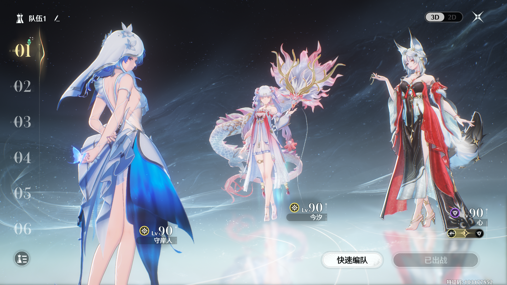

这让“现在切不切”成为有内容的决定。提前切走能躲开风险，却可能丢失一段收益；坚持完成动作能补齐协奏，却可能错过敌人的安全窗口。切换因此不只是按顺序播放三套技能，而是在收益完整性与现场变化之间取舍。

它也建立了角色差异：有人擅长快速交接，有人需要一段完整站场，有人可以在后台继续贡献。角色养成的价值必须放到这条时间线上判断。一个角色强化了个人输出，却明显延长交接时间，队伍收益可能低于面板所暗示的提升。

后续扩展的难点，是不能让所有新角色都向“更短站场、更高后台、更强增益”同时收敛。那会不断挤压旧角色的位置，也使角色看似越来越强，实际选择越来越少。不同角色应当保留不同的时间结构，并拥有能够发挥这种结构的敌人和关卡。

### 闪避与招架

极限闪避和针对可招架攻击的反击，把防守动作转成反击、破坏敌人节奏或争取输出空间的机会。风险与收益发生在同一瞬间，能让成功明显区别于被动躲避。[\[0\]](#ref_0)

这种反馈的重要性不只是爽感。它让玩家知道，失败除了继续堆数值，还存在一个可学习的改进方向：识别动作、控制距离、选择出手时点。养成因此有机会成为容错和风格选择，而不是解决所有问题的唯一答案。

不过，机制上可应对不代表体验上可读。多人特效、镜头偏转、场景遮挡和移动端操作都可能让提示失去实际作用。若玩家看不到危险来源，再宽松的理论窗口也未必有帮助。

### 多套能量分别管理什么

协奏主要组织角色交接，共鸣能量约束解放频率，共鸣回路服务角色自己的关键动作。它们分工不同，但会在同一套操作中同时积累和消耗，因此能形成循环规划，也增加了学习负担。[\[0\]](#ref_0)

3.0 增加敌人偏谐、失谐与谐度破坏等规则，并为部分角色提供共鸣模态切换。它把部分队伍判断从“我方资源是否准备好”扩展到“敌人是否进入可利用的状态”。[\[2\]](#ref_2)这种扩展有价值的前提是新状态真的改变了出手选择。玩家需要能够观察进度、预测窗口，并决定由谁处理；模态则有机会让同一角色适应不同队伍，降低横向尝试成本。

### 属性、伤害类型与触发标签

鸣潮的属性抗性、伤害归类、增益条件与特定机制标签，共同决定队伍适用范围。[\[0\]](#ref_0)[\[2\]](#ref_2)属性可以给敌人适配和关卡轮换提供维度，普攻、重击、技能、解放等归类可以定义队友和装备收益，特定触发条件则进一步形成构筑接口。因此，评估一条标签的设计价值，应该考虑一下三个方面：它能否在实战中被看见；是否允许不止一种配队满足；离开当期环境后是否仍有用途。若三个答案都偏弱，这条标签就更像短期筛选条件，而不是能够长期积累的系统深度。

### 实战兑现率

相同装备下，纸面输出与实际成绩之间还隔着增益覆盖、动作完成、命中、敌人可攻击时间和生存中断。这些因素会互相影响：更高容错可能让玩家完成原本会被打断的连段，位移能力可能缩短追击时间，治疗可能减少为了保命而提前交接的次数。因此，生存和便利并非与伤害完全分开的“舒适度”。对特定玩家，它们能提高有效输出时间，进而提高实际成绩。只按理想站桩排行设计奖励门槛，容易低估真实操作环境中的成本。

## 七、资源与探索：持续投入不等于填满时间

### 波片与结晶单质：保护断更后的回归，而不是消除全部损失

结晶波片每 6 分钟恢复 1 点，上限 240；波片达到上限后，结晶单质按每 12 分钟 1 点累积，上限 480。结晶单质是在既有体力上增加缓冲，并非满额等速保存全部自然恢复量。[\[0\]](#ref_0)[\[6\]](#ref_6)

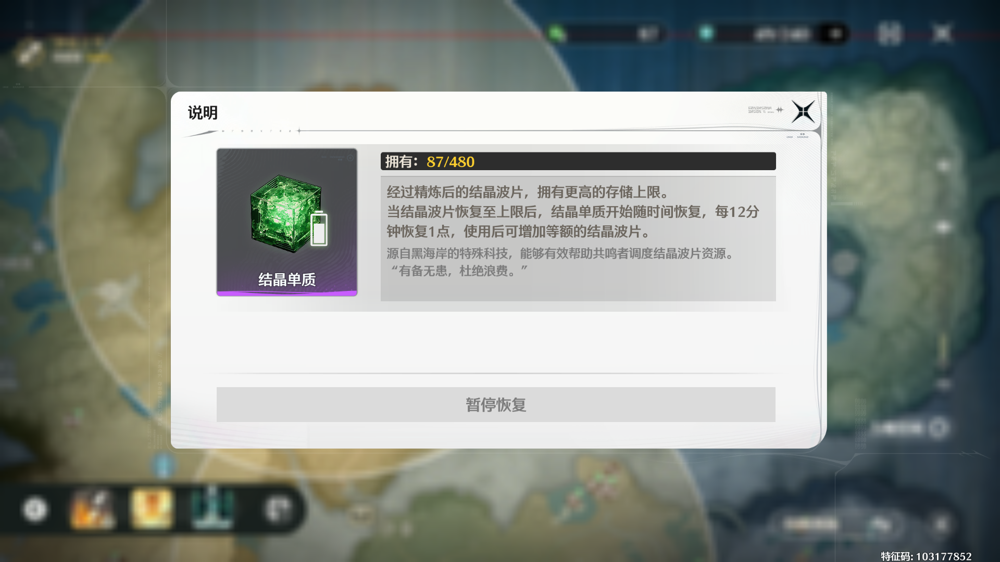

这一区别影响体验判断。缓冲让玩家偶尔没有登录时，不至于损失全部溢出资源；但储存效率较低，仍保留按时消耗的动机。它把“错过一天就完全浪费”改成“晚些回来仍有积累”，没有完全取消时间约束。从长线关系看，系统愿意容纳玩家的生活中断很重要。玩家停几天后打开游戏，如果先看到一批可用于推进目标的资源，容易重新开始；如果先看到一串已经错过的机会，回归的第一感受就是落后。这里应防止用短期登录频次否定缓冲设计。减少一次为了清体力而打开游戏的行为，未必是损失；若换来更高的次周回访和更少的放弃，整体可能更健康。

### 日、周与版本节奏，应分别承担不同任务

日常资源适合给当前目标提供连续的小步进展；周常适合安排较完整的挑战与阶段结算；版本内容则负责新角色、新地域、新叙事和新的长期目标。

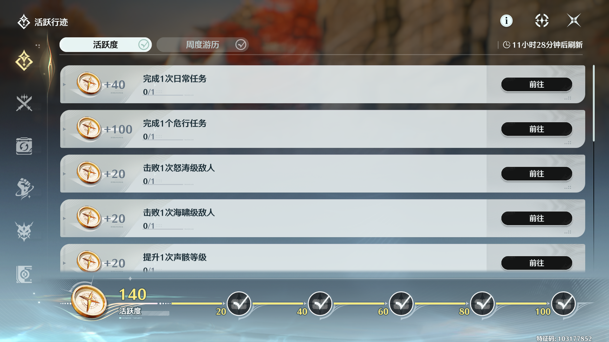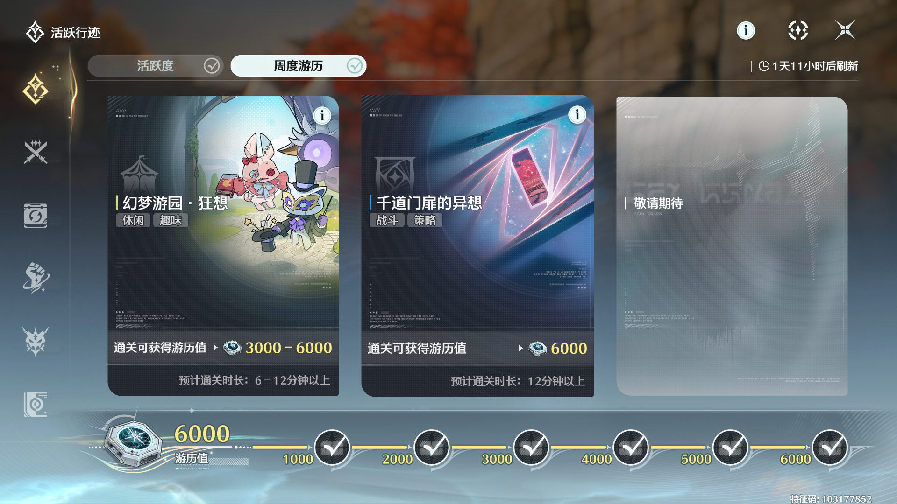

当多个玩法都把主要奖励绑定在重复战斗、逐项领取和相近的养成材料上，玩家感受到的是待办叠加。单个玩法的奖励效率可能不错，合在一起却超过愿意稳定投入的时间。评价一项新增常驻内容，必须计算它替代了什么，不能默认所有新增分钟都是净增兴趣。

对成熟账号，资源目标也会从“缺什么补什么”转向“是否值得再开始一个角色”。这时继续增加低决策的获取入口，未必能带来新的投入。更有效的承接可能是可复用的配装、清楚的成队路径，以及能让旧角色重新派上用场的挑战。

### 探索收益

采集物、敌人材料与声骸把角色养成接进开放世界。玩家为了喜欢的角色前往某个区域，沿途遭遇、景观和支线又可能带来超出材料的收获。这是养成对探索最有价值的带动方式。[\[0\]](#ref_0)

同样的路线也可能反过来损害探索。当素材缺口很急、路线过于固定、重复次数过多时，玩家会主动过滤景观与叙事，只保留导航和采集点。世界没有变小，但在玩家眼里变成了资源坐标表。

所以采集设计应区分初次认识与重复补充。第一次可以强调环境辨识、空间关系和区域特色；多次培养之后应提高追踪、集中获取或有限替代的便利。3.1 的素材追踪与 3.2 的就近追踪优化，正是把后续重复过程从人工查图中解放出来。[\[3\]](#ref_3)[\[4\]](#ref_4)

### 移动效率提高之后，内容密度标准也跟着提高

3.0 的科考摩托把驾驶、疾驰、漂移和模块成长接进区域探索。移动工具既是效率设施，也可以成为外观收集、操控体验和地区身份的一部分。[\[2\]](#ref_2)

更快移动会减少无内容的路程，让玩家更愿意去远处完成养成目标；同时也会缩短景观和遭遇的暴露时间。原本步行时足够密集的内容，在高速移动下可能显得稀疏。成熟阶段的设计任务不是把路重新拉长，而是让停下来的理由更有区分：一次有条件的战斗、一段能改变路线的探索、一个有叙事价值的发现。跑得快和世界有内容并不冲突，但二者需要按同一速度重新组织。

### 常驻区域成长：重复游玩必须留下可见的变化

3.7 新增常驻玩法「心影映花」。玩家在不同心域收集对应衍世千瓣，交予定心台，推动定心台等级和心域稳定值，并使天罗狐影的态度发生变化。这里把分散的探索行为汇总成了区域层面的持续反馈。[\[1\]](#ref_1)[\[14\]](#ref_14)这类结构比单纯重复领取材料多了一层长期反馈：玩家的行动在区域中留下了可见的变化。区域状态和角色态度的变化，能把个人收集外化为世界进度，给不追求极限输出的玩家另一种完成感。

### 剧情、飞讯与历程回顾

3.0 飞讯以角色联系、对话和相关任务扩展日常交流；3.7 历程回顾提供已完成剧情的回看入口。这些系统连接的是角色认同与记忆，而不是直接增加伤害。[\[2\]](#ref_2)[\[1\]](#ref_1)

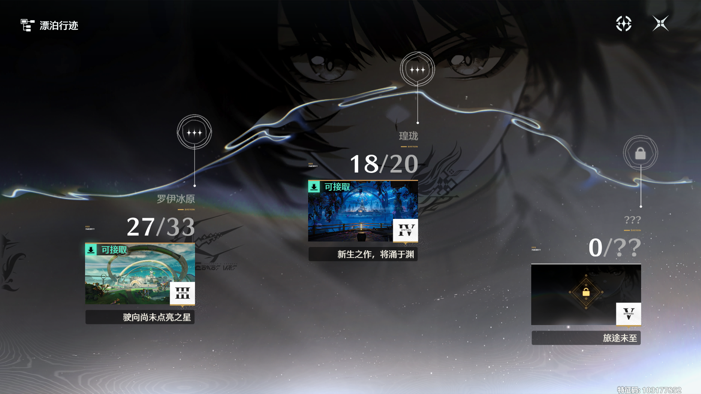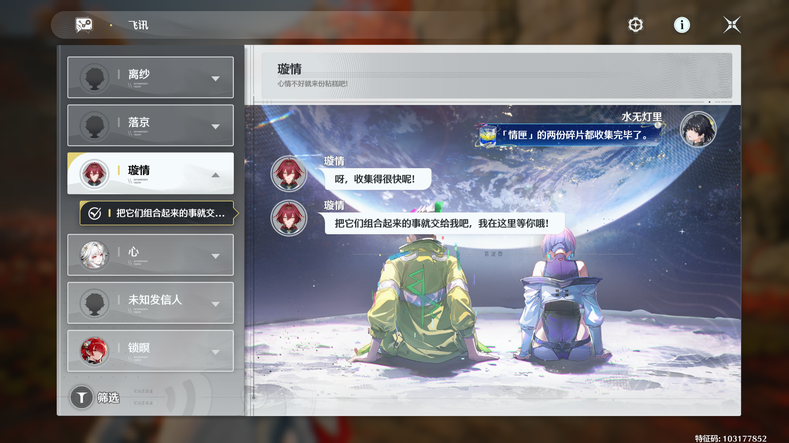

对喜欢一个角色的玩家，养成中的小幅提升未必每天都值得关注，但角色关系的延续、过往情节的重访，可以让投入仍有情感回报。它们能扩大角色价值的来源，避免角色一旦不再适合高难，就被理解为“完全没有用了”。

这里需要克制奖励绑定。把每段对话变成必须领取的材料任务，可能提高点击量，却让关系体验变成签到。并非每个系统都要直接承担日活；有些内容的价值恰好在于玩家愿意主动回来，而不是害怕错过奖励才回来。

## 八、终局玩法：定义什么值得培养

### 逆境深塔

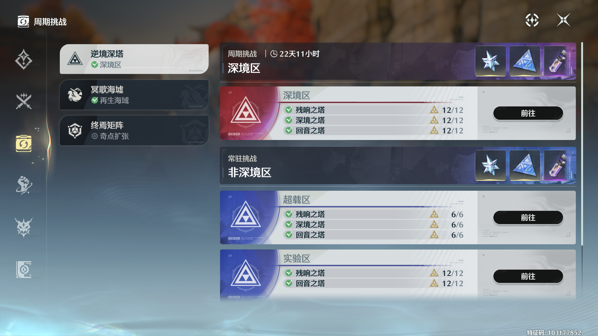

逆境深塔通过关卡、限时目标、环境效果和角色出战约束组织挑战。角色不能无限承担所有关卡，因而不仅需要一支强队，还需要决定有限阵容应该放在哪一段。[\[0\]](#ref_0)这给横向养成一个明确用途。多培养一名辅助或第二个输出，不一定让最高单次伤害更高，却可能让整套关卡安排更完整。角色池的价值从“能选多少人”，转为“能同时解决多少问题”。但宽度需求会放大共享资源的瓶颈。一名通用辅助可以支持多支理论队伍，却不能在受限条件下同时服务所有安排；换队需要的额外装备与材料，也不能被角色数量掩盖。计时能让成长收益清楚可见，也会让生存和探索功能难以获得同等评价。它适合作为终局的一种标准，但不宜成为所有常驻挑战唯一的标准。否则系统提供的角色差异会在结算时被压回同一个输出排名。

### 环境轮换

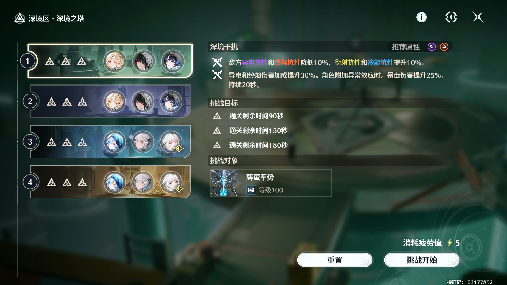

抗性、敌人行为、增益触发和阶段目标，都能改变不同队伍的适用性。相比只加血量，条件式环境更有机会让角色功能被重新看见；相比直接修改旧角色，它也更容易控制影响范围和持续时间。[\[0\]](#ref_0)不过，“角色数值没改”不能作为旧投入没有贬值的证明。玩家买到的不是一张永远不变的属性表，而是一段可持续使用的体验。若环境连续收窄，旧角色需要明显更高的操作和投入才能取得相同结果，功能上的折价同样真实。抗性变化还可能被低估。仅作机制示例：假设处于线性抗性区间、没有其他减抗，抗性从 20% 变为 35%，对应伤害因子从 0.80 变为 0.65，同配置伤害下降 18.75%；恢复原输出需约 23.08% 的其他环节增幅。因此，环境说明必须告诉玩家“为什么这期不同”和“有哪些解决路径”。

### 冥歌海墟

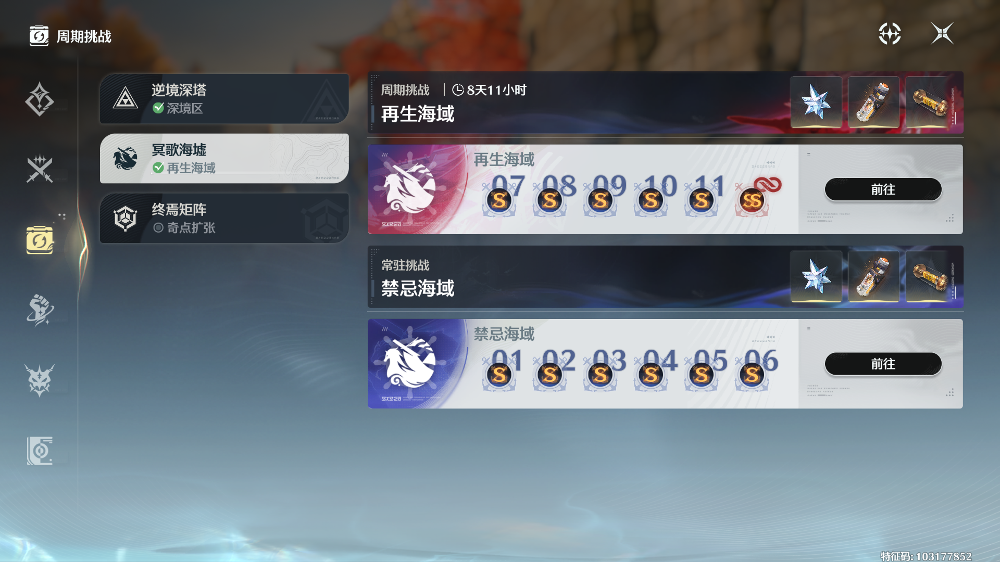

冥歌海墟以区域累计积分、多队安排、信物和焚潮相关机制组织挑战。与逐间追求最短通关不同，累计成绩与玩法内增益，有机会让阵容、目标选择和操作贡献形成另一种组合。[\[0\]](#ref_0) 官方 2.1 公告确认其作为常驻挑战推出。[\[12\]](#ref_12)这种差异能降低单一高难标准的垄断：有的队伍擅长处理连续敌群，有的擅长集中爆发，有的从特定信物获得更明显收益。养成不必只服务同一个单体输出模板。记录复写等重复挑战优化也应服务于这一分工：已经证明过的低压力流程可以压缩，把操作时间留给新条件和新决策。自动复写不能替代新内容，却能避免旧验证长期占用玩家的注意力。

### 终焉矩阵

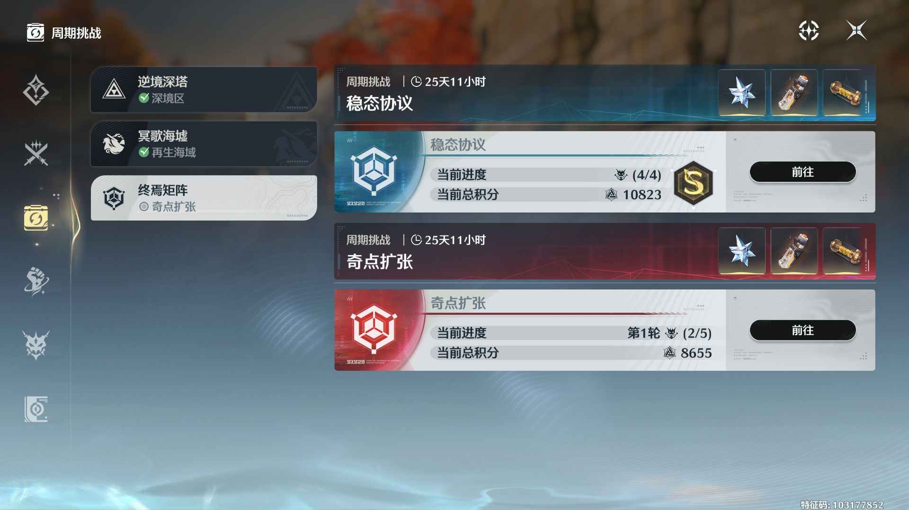

3.2 公告确认终焉矩阵在 2026 年 3 月 26 日开启；3.0 已存在相关矩阵先行玩法。[\[4\]](#ref_4)[\[2\]](#ref_2) 稳态协议与奇点扩张，分别呈现相对明确的阶段目标和更长的推进追求。[\[0\]](#ref_0)

多队与持续增强的挑战，能够为资深账号提供更多培养用途，让角色储备不再只围绕少数最优队伍，前置成绩门槛可以控制初次体验，避免完全没有准备的玩家被强度劝退。版本扩展不能只让每种终局都需要更多队伍。若所有玩法同步抬宽度与深度，资源排程的总压力会叠加，玩家的自由排序反而下降。不同终局之间需要错开主要考题。

### 异想与全息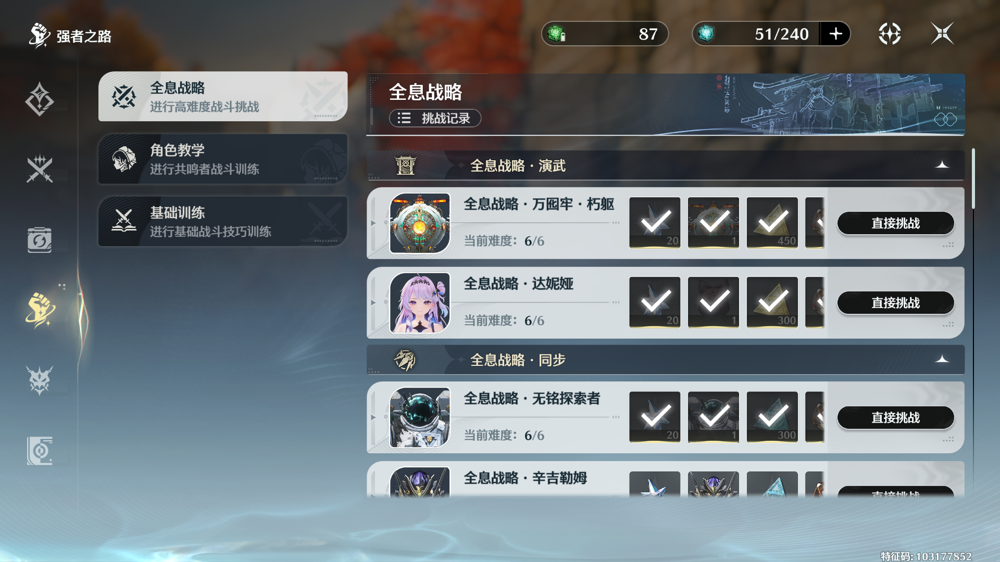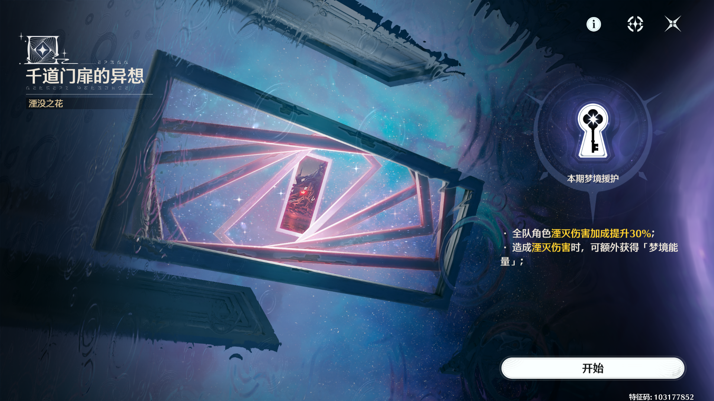

官方将「千道门扉的异想」介绍为周常玩法；其局内强化结构与永久养成不同，能让玩家在一轮游玩中较快经历选择、成型和验证。[\[11\]](#ref_11)[\[0\]](#ref_0)临时构筑的价值，是给长期养成提供试验场。玩家可以感受异常组合和阶段爆发，不必为每次尝试先投入完整角色成本。全息战略则更适合突出敌人学习、动作应对和个人完成感。[\[0\]](#ref_0) 它给“角色已经养好，玩家还可以进步”保留了空间。与持续膨胀的养成相比，清楚掌握一个敌人的行为模式，是更能被玩家归因于自己的成长。

终局组合的理想分工，是让账号宽度、构筑理解、个人操作和极限输出分别有舞台。不是每个人都必须完成所有舞台，但不同兴趣应能得到明确反馈。这样养成才能提供多条值得继续的路线，而不是一条越来越长的毕业清单。

## 九、经营影响：日活、月活、收入与长期兴趣

### 先区分经营结果

角色养成可以影响四类结果，但作用路径不同。它直接改变资源获取与使用行为，间接改变角色满意度、回访和付费；其中任何一条都可能被内容质量、角色偏好、版本节奏和玩家生活状态改变。

| 关注结果 | 角色养成可能产生的正向路径 | 同一设计可能产生的反向路径 |
| --- | --- | --- |
| 日活与活跃频次 | 明确短期目标 → 今天有可完成的进展 → 再次进入游戏 | 连续没有提升 → 只为清资源登录 → 逐渐回避养成 |
| 月活与跨版本回访 | 喜欢的角色有长期用途 → 新内容能接续旧投入 → 愿意回来 | 返回后要补过多材料与机制 → 角色仍不可用 → 再次离开 |
| 角色、武器与深度投入 | 获取后体验兑现 → 建立信任 → 扩队或进一步补强 | 已获取角色积压 → 完整使用成本过高 → 降低下一次投入 |
| 长期游玩兴趣 | 自己的选择、操作与积累能改变结果 → 持续研究 | 每期只剩外部标准答案 → 投入像补作业 → 失去自主目标 |

这四条路径的共同中介，是“角色价值有没有被使用出来”。因此，养成系统的评价应关注“获取之后有多少角色真正进入玩家的常用内容”。

### 对日活

确定性的突破材料、技能节点和明确缺口，可以给每天的登录一个具体理由。玩家知道今天完成哪一项，明天就能尝试新的队伍。这种频次来自对结果的预期，完成一次目标后也较容易转向下一个目标。

随机精修同样可以维持高频尝试，但其中混合了两类行为：一类是队伍已经可用，玩家主动追求更好；另一类是始终没有达到自己认为的最低标准，不得不继续。两者的登录曲线可能相似，后续留存和满意度却未必相同。声骸优化因此不能只观察刷取次数。如果次数下降、首次成队更快、新角色使用更广、后续回访稳定，这是重复负担下降；如果次数下降的同时目标放弃增加、有效内容参与减少，才更接近兴趣衰退。

结晶单质、批量处理与堆叠存储也有类似逻辑。它们可能压低某些登录和界面停留，但把玩家的注意力还给了战斗与探索。

### 对月活：让玩家离开一段时间后，仍然看得见重新投入的入口

本文将日活 DAU 定义为自然日内完成有效会话的去重账号数，月活 MAU 定义为自然月内完成有效会话的去重账号数，使用同一账号去重和服务器时区口径。MAU 是集合的去重结果，不是把每天的 DAU 相加；日均 DAU/MAU 反映频次结构。

对鸣潮这类按版本投放内容的游戏，有些玩家会集中体验剧情和角色，再降低登录频率。不能仅因为他们不是每天刷取，就认为他们没有长期价值。养成系统应允许这种节奏：旧库存仍有意义，旧队伍能处理基础内容，新目标的准备过程可理解。真正会影响跨月回访的，是回来的第一段体验。玩家被新角色吸引回来，却发现队友、材料入口、装备规则和挑战门槛都需要补齐，兴趣可能在第一次有效使用之前耗尽。回归奖励若只有通用资源，却没有解除实际瓶颈，也可能看起来丰厚、用起来帮助有限。3.0 的海歌重奏升级已包含日常探索试用角色与培养材料入口助力。[\[2\]](#ref_2) 这说明回归支持不只是补发资源，也在尝试提前交付使用体验。

月活应进一步拆成当月新增、上月延续活跃和更早流失后的回流三组。养成入口优化主要影响后两组中的特定阶段，不能把同期新角色宣传带来的新增全部归给系统优化。评价回流也不能只算当天回来的人，还要看回归后能否完成第一个目标，以及次月是否仍有自主选择的内容。

### 对收入：获取之后的使用体验，决定下一次投入的可信度

角色养成与收入的关系不是“材料越缺，付费越多”。缺口能够产生补足动机，但也可能使玩家缩减角色获取计划。需要同时分析本次投入深度与未来投入次数。

在同一活跃账号与实收口径内，可把月度玩家付费流水拆为：MAU × 月付费渗透率 × 月付费用户平均流水（ARPPU）。这是经营拆分，不是财务确认收入公式；退款、渠道分成和递延确认应另行处理。单项优化可能同时改变三个因子，不能只观察其中一个。

角色获取主要提供新体验和阵容扩展；武器提供相对聚焦的补强；共鸣链承接对某个角色更深的投入；月度资源产品则把预算与持续游玩联系起来。[\[0\]](#ref_0)[\[7\]](#ref_7)例如，降低基础成队成本，可能减少某些养成补给需求，却让玩家愿意再培养一个角色，增加横向获取；提高声骸复用度，可能降低重复刷取，却扩大新角色与现有账号的兼容范围。反过来，若免费替代无法满足基本循环，专武获取率可能上升，但角色获取后的弃用和后续不再付费也可能上升。共鸣链需要尤其谨慎。让深度投入提供鲜明的效率、玩法变化和喜爱表达，可以形成自愿升级；让零链承担明显缺口，再出售恢复正常循环的能力，则会影响玩家对完整角色价格的预期。这种预期还会传给未获取的玩家，降低他们进入这条付费路径的意愿。唤取的保底计数继承与武器目标确定性，降低的是规划风险。它们可以帮助玩家相信中途投入不会完全失去价值，[\[0\]](#ref_0)[\[7\]](#ref_7)判断长期收入，应观察获取后使用、跨角色复购、复刻选择和付费留存，而不只是单期卡池峰值。

### 对游玩兴趣：角色养成要提供四种不同的满足

长期兴趣可拆解为四个玩家能感知的问题：能否自主选择目标；是否比以前更熟练地使用角色；投入是否确实留下了成果；下一个目标是否与上一个有区别，它们分别对应自主选择、掌握、积累和新鲜感。例如：

| 具体时刻 | 玩家可能形成的感受 | 接下来更可能出现的选择 |
| --- | --- | --- |
| 关键技能点开，第一次顺利打完整轮 | 自己的投入有效，角色终于成型 | 主动尝试更完整的队伍 |
| 换上充能装备，纸面伤害下降但连续两轮更顺 | 理解比单纯堆分数更有用 | 愿意研究属性与循环 |
| 连刷多次，当前目标仍看不到进展 | 失去对成本的预期 | 停养、改目标，或勉强继续 |
| 新角色能复用已有武器和辅助 | “账号积累正在帮助我” | 更愿意尝试新角色 |
| 旧角色在新环境中仍有独特任务 | 过去的喜爱没有白费 | 愿意保留并再投入 |

## 十、结论：养成的终点不只是面板

《鸣潮》的重要系统基础，是角色机制、队伍时序和装备条件能够互相解释。玩家对角色理解得更深，投入方式就可能不同；队伍和敌人条件改变，旧资源也有机会找到新的用途。好的角色养成，应当让玩家先把喜欢转化成使用，再把使用转化成研究，把研究转化成下一段自愿投入。确定性负责建立基础，随机性负责保留惊喜，战斗负责验证理解，内容更新负责扩展用途；商业化则建立在这些价值能够兑现的前提上。

从持续游玩体验出发，角色养成应兼顾旧角色的持续使用价值与新角色的成型负担，避免新角色获取后立即转化为长期待完成的培养任务。从系统策划角度看，这既是体验目标，也是值得验证的经营命题：当每一次投入更容易形成可用、可理解、可持续的成果，玩家才更有理由相信下一次投入。

## 参考文献

\[1\] KURO GAMES：《鸣潮》中国区 App Store 开发者版本记录，3.7.0，2026-09-30。核对 3.7 基准、声骸堆叠、模态推荐、历程回顾与心影映花等新增内容。  [查看开发者版本记录](https://apps.apple.com/cn/app/%E9%B8%A3%E6%BD%AE/id6450693428)

\[2\] 鸣潮官方版主：《「我们生而眺望」3.0 版本内容说明》，TapTap，2025-12-25。核对合鸣条件、共鸣模态、偏谐相关规则及版本系统接口。  [查看官方公告](https://www.taptap.cn/moment/752979031825058423)

\[3\] 鸣潮官方版主：《「赠予雪中的你」3.1 版本内容说明》，TapTap，2026-02-05。核对定向融合、辅音重构、主音重构批量处理与素材追踪。  [查看官方公告](https://www.taptap.cn/moment/768413388739972380)

\[4\] 鸣潮官方版主：《「于影中启明的决心」3.2 版本内容说明》，TapTap，2026-03-19。核对终焉矩阵 2026-03-26 开启、素材与声骸界面优化。  [查看官方公告](https://www.taptap.cn/moment/783639393251361596)

\[5\] 鸣潮官方版主：《「自星海尽处回响」3.3 版本内容说明》，TapTap，2026-04-30。涉及新增地区黯原及相关版本时间线。  [查看官方公告](https://www.taptap.cn/moment/798617402794315766)

\[6\] 鸣潮官方：《1.2 版本内容说明》，2024-08-15；及版本前瞻中的结晶单质说明。用于说明体力缓冲设计；相关基础参数见正文。  [查看官方版本说明](https://mc.kurogames.com/main/news/detail/1193)

\[7\] 鸣潮官方版主：武器活动唤取公告，TapTap，2025-11-19。核对五星获得目标与同类型活动保底计数共享规则；未据此推算抽取期望。  [查看官方唤取公告](https://www.taptap.cn/moment/740160365484050009)

\[8\] GameKee 鸣潮图鉴：《折枝》，游戏技能与装备文本转录，页面标注数据来自鸣潮官方社区库街区。仅用于折枝相关装备的触发条件与伤害归类示例。  [查看技能与装备文本](https://www.gamekee.com/mc/627615.html)

\[9\] GameKee 鸣潮图鉴：《今汐》，游戏技能文本转录。仅用于第二链脱战补充韶光的机制示例；场景价值判断为本文分析。  [查看技能文本](https://www.gamekee.com/mc/624686.html)

\[10\] 鸣潮官方版主：《角色＆武器忆旅唤取活动说明》，TapTap，2026-06-26。核对 3.5 忆旅获取入口的公布，不使用未核验的图片内成本与概率信息。  [查看官方公告](https://www.taptap.cn/moment/819636354391474322)

\[11\] 鸣潮官方版主：《「千道门扉的异想」玩法即将开启》，TapTap，2025-02-10。核对其版本周常玩法定位。  [查看官方公告](https://www.taptap.cn/moment/638048106214064870)

\[12\] 鸣潮官方：《2.1 版本更新维护预告》，2025-02-11。用于核对冥歌海墟作为常驻挑战的版本归属。  [查看官方维护预告](https://mc.kurogames.com/main/news/detail/2116)

\[13\] Wuthering.gg 游戏指南：《联觉等级与联觉经验》《索拉等级提升·一》，游戏帮助文本转录。用于核对账号等级推进、索拉等级与奖励／敌人危险程度的关联；该网站并非库洛官方网站。  [联觉等级与联觉经验](https://wuthering.gg/zh-Hans/guide/system/union-level--union-exp) / [索拉等级提升](https://wuthering.gg/zh-Hans/guide/system/sol3-phase-ascension-i)

\[14\] Wuthering.gg 游戏指南：《心影映花》《心影映花·衍世千瓣交予》，游戏帮助文本转录。用于核对收集、定心台提交与心域稳定值的基础链路；该网站并非库洛官方网站。  [心影映花总览](https://wuthering.gg/zh-Hans/guide/system/blooms-for-the-shadow) / [衍世千瓣交予](https://wuthering.gg/zh-Hans/guide/system/delivering-blooms-for-the-shadow-thousandfold-petals)
